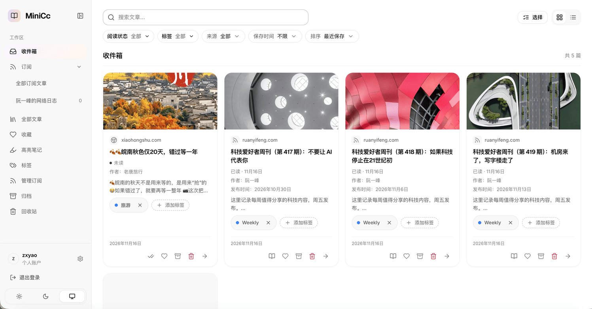
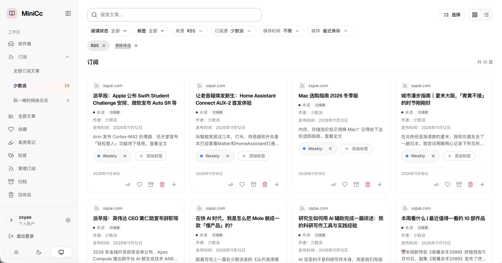
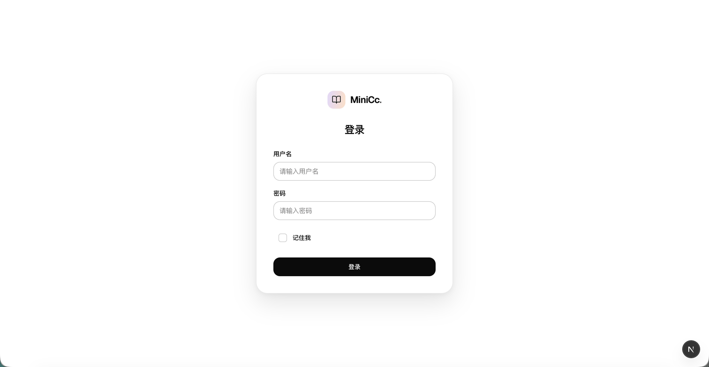
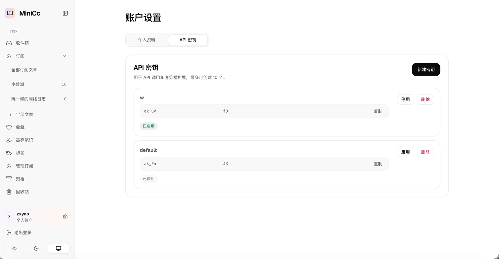
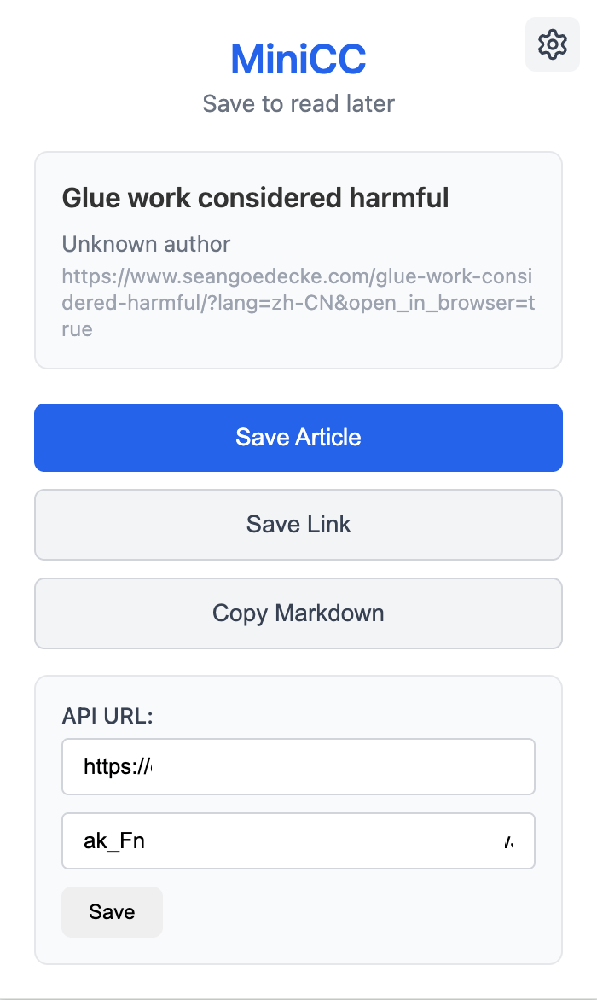

# MiniCC (Mini Cut Collection) - Read Later Application

[Omnivore](https://github.com/omnivore-app/omnivore) minimum implementation, built with ASP.NET Core and Next.js.

## Features

- **Save Pages**: Save the current page as a full article or as a link through the Chrome extension, or copy it as Markdown; read and manage saved items on the website
- **RSS / Atom Subscriptions**: Subscribe to feeds, apply default tags to new entries, and browse articles by feed
- **Search and Filters**: Full-text search, plus filters for reading status, tags, source, feed and save date, in grid or list view
- **Tagging**: Organize articles with custom tags and colors
- **Highlighting**: Add highlights and notes to article content, and review them on the Highlights page
- **Favorites, Archive & Trash**: Mark articles as favorites, archive them, act on several at once, and restore deleted articles from the trash
- **API Keys**: Create up to 10 keys for the browser extension and programmatic access
- **Responsive UI**: Modern, responsive interface built with React and CSS Modules, with light, dark and system themes

## Screenshots

| Library | RSS subscriptions |
| --- | --- |
|  |  |
| **Highlights** | **Sign in** |
|  |  |

## Tech Stack

### Backend
- **ASP.NET Core 10.0** - Web API framework
- **Entity Framework Core** - ORM for database operations
- **PostgreSQL or SQLite** - Configurable database provider
- **HtmlAgilityPack** - HTML image URL rewriting

### Chrome Extension
- **@mozilla/readability** - Extract article content from the loaded page
- **DOMPurify** - Sanitize extracted HTML

### Frontend
- **Next.js 15** - React framework with App Router
- **TypeScript** - Type-safe JavaScript
- **SCSS** - CSS preprocessor for styling
- **Axios** - HTTP client for API requests

## Project Structure

```
.
├── Directory.Build.props      # Shared .NET build settings
├── Directory.Packages.props   # NuGet package versions
├── package.json              # Web dependencies and root build commands
├── pnpm-workspace.yaml        # JavaScript workspace
├── pnpm-lock.yaml             # Shared JavaScript lockfile
├── deploy/                   # Compose files and deployment scripts
└── src/
    ├── init-db.sql            # PostgreSQL database setup
    ├── init-db-text-search.sql # PostgreSQL text search setup
    ├── server/                # ASP.NET Core API
    ├── web/                   # Next.js app and static assets
    ├── web-extension/         # Chrome extension
    ├── content-handler/       # Content extraction SDK
    ├── image-proxy/           # Image proxy
    └── ng/                    # Nginx configuration
```

## Getting Started With Podman

Navigate to the repository's root directory:

```bash
podman compose -f ./deploy/docker-compose.yaml up -d --build
```

For a new SQLite deployment, use the SQLite Compose file:

```bash
podman compose -f ./deploy/docker-compose.sqlite.yaml up -d --build
```

Open http://localhost:5000. The SQLite database lives in the `sqlite-data` volume. Stop the active Compose stack with `down` before switching files because both stacks use the same container names.

## Getting Started

### Prerequisites
- .NET 10.0 SDK
- Node.js 22.13+ and pnpm 12.5.1 (install pnpm with `npm install -g pnpm@12.5.1`)
- PostgreSQL 16 with zhparser if using PostgreSQL

### Backend Setup (PostgreSQL)

1. Navigate to the backend directory:
   ```bash
   cd src/server
   ```

2. Install Entity Framework tools (if not already installed):
   ```bash
   dotnet tool install --global dotnet-ef
   ```

3. Configure the database and image proxy in the API environment:
   ```bash
   export MiniCC_Db="Host=127.0.0.1;Database=mini_cc;Username=postgres;Password=your_password"
   export ImageProxy__ProxyUrl="http://localhost:5050"
   export ImageProxy__SignatureKey="your-image-proxy-secret"
   ```
   Run imageproxy with the same signing key. In Compose, set `IMAGE_PROXY_SECRET`; both services receive it. The default proxy URL `/imageProxy` routes through nginx. No page extraction service is needed.

4. Run the backend API. It initializes zhparser and applies migrations on startup.
   ```bash
   dotnet run
   ```

The API will be available at `http://localhost:5001`.

### Backend Setup (SQLite)

```bash
cd src/server
Database__Provider=sqlite ImageProxy__SignatureKey=your-image-proxy-secret dotnet run
```

On startup the API creates `data/mini_cc.db` under the project directory and applies the SQLite migrations. `Database:Provider` accepts `postgres` (default) or `sqlite`, case-insensitively. `MiniCC_Db` overrides `ConnectionStrings:DefaultConnection` for PostgreSQL or `ConnectionStrings:Sqlite` for SQLite. Relative SQLite paths resolve from the API content root.

Use SQLite for a new deployment with one API instance and local storage. SQLite uses WAL. Keep the database on a local disk or a local named volume.

- Article search matches substrings in the title, summary, author and HTML body. It ignores ASCII letter case and scans the fields for both the result list and its count. Markup and escaped entities can affect body search results. PostgreSQL uses zhparser for Chinese text search.
- SQLite sorts tag names and feed titles using binary ordering. It relies on API validation for field length limits.
- Back up SQLite by stopping the API and copying the database and any remaining WAL files together. A host with the SQLite CLI can use `sqlite3 /path/to/mini_cc.db ".backup /path/to/backup.db"` while the API runs.
- If a killed migration leaves startup waiting on `__EFMigrationsLock`, stop the API, confirm no migration is running, and clear the table with `DELETE FROM "__EFMigrationsLock"`.

### Frontend Setup

1. Install the workspace dependencies from the repository root.

   ```bash
   pnpm install --frozen-lockfile
   ```

2. Set the API URL in `src/web/.env.local` if needed.

   ```dotenv
   NEXT_PUBLIC_API_URL=http://localhost:5001/api
   ```

3. Run `pnpm dev` from the root and open http://localhost:4000.

### Web Extension

1. From the repository root, run `pnpm install --frozen-lockfile` if you have yet to install the workspace.
2. Run `pnpm build:ext` from the root.
3. Open `chrome://extensions/`, enable Developer mode, and load `src/web-extension/dist` as an unpacked extension. Reload the extension and article tabs after rebuilding.
4. Sign in to the website, click your account at the bottom of the sidebar, and create a key on the **API 密钥** (API Keys) tab.

   

5. Open the extension popup, click the gear icon, and enter the API URL (the address that serves `/api`, such as `http://localhost:5000`) and the API key.

   

The popup offers **Save Article**, **Save Link** and **Copy Markdown**. Save Article extracts and sanitizes the current page, then sends the original HTML, readable HTML, and metadata to the API. The API stores the article and signs image URLs; it does not fetch the source page. Existing saved articles remain unchanged.

## API Endpoints

### Articles
- `GET /api/articles` - Get all articles (with pagination and search)
- `GET /api/articles/{id}` - Get specific article
- `POST /api/articles/content` - Save extracted article HTML and metadata from the Chrome extension
- `PUT /api/articles/{id}` - Update article
- `DELETE /api/articles/{id}` - Delete article
- `POST /api/articles/{id}/favorite` - Toggle favorite status
- `POST /api/articles/{id}/archive` - Toggle archive status

### Tags
- `POST /api/articles/{id}/tags` - Add tag to article
- `DELETE /api/articles/{id}/tags/{tagId}` - Remove tag from article

### Highlights
- `POST /api/articles/{id}/highlights` - Add highlight to article
- `DELETE /api/highlights/{id}` - Delete highlight

## Development

### Backend Commands
```bash
# From the repository root
dotnet build
dotnet run --project src/server/MiniCc.Api.csproj
dotnet test
```

For EF migrations, run these commands in `src/server`.

```bash
# Generate both migrations when changing the model
Database__Provider=postgres dotnet ef migrations add MigrationName --context MiniCcDbContext
dotnet ef migrations add MigrationName --context SqliteMiniCcDbContext --output-dir Migrations/Sqlite

# Apply manually to an initialized PostgreSQL database or to a SQLite file
Database__Provider=postgres dotnet ef database update --context MiniCcDbContext
dotnet ef database update --context SqliteMiniCcDbContext --connection "Data Source=/absolute/path/to/mini_cc.db"
```

### Database Tests

The SQLite tests use temporary local database files and run without Docker.

```bash
dotnet test test/MiniCc.Api.Test --filter "FullyQualifiedName~Sqlite|FullyQualifiedName~Database"
```

### Frontend Commands

Run these commands from the repository root.

```bash
pnpm dev
pnpm build:web        # Production build in src/web/.next
pnpm start
pnpm lint
pnpm test
```

### Web Extension Commands

```bash
pnpm build:ext        # Chrome extension in src/web-extension/dist
pnpm --filter minicc-extension dev
pnpm --filter minicc-extension lint
pnpm --filter minicc-extension test
```

## Database Schema

The application uses three main entities:

- **Articles**: Store saved web content with metadata
- **Tags**: Organize articles with custom labels and colors
- **Highlights**: Text selections and notes within articles

All entities include created/updated timestamps and proper relationships.

## Contributing

1. Fork the repository
2. Create a feature branch
3. Make your changes
4. Run tests and ensure builds pass
5. Submit a pull request

## License

This project is licensed under the MIT License.

Imageproxy was copied from [Omnivore](https://github.com/omnivore-app/omnivore) with minor modifications. Article extraction uses the official [Mozilla Readability](https://github.com/mozilla/readability) package in the Chrome extension.
