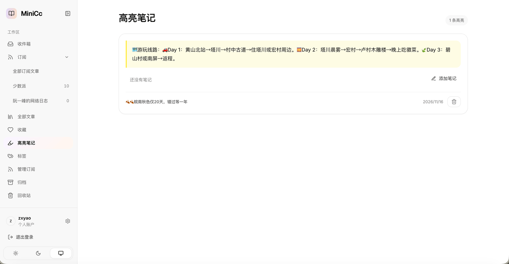

# MiniCC

**A self-hosted mini web clipping & collection app.**

Clip web pages with the Chrome extension, follow RSS and Atom feeds, then read, highlight and organize everything in a library that runs on your own server. MiniCC (Mini Cut Collection) started as a minimal implementation of [Omnivore](https://github.com/omnivore-app/omnivore) and is built with ASP.NET Core and Next.js.

> The web interface is in Simplified Chinese. This guide gives each interface label with an English translation, for example **收件箱** (Inbox).

## Contents

- [Features](#features)
- [Screenshots](#screenshots)
- [Installation](#installation)
- [Usage](#usage)
- [Development Guide](#development-guide)
- [Contributing](#contributing)
- [License](#license)

## Features

- **Web clipping**: Save the current page as a full article or as a link with the Chrome extension, or copy it as Markdown. The extension extracts content in your browser, so you can also save pages that require you to sign in.
- **RSS / Atom subscriptions**: Subscribe to a feed or a website, apply default tags to new entries, and browse articles by feed.
- **Search and filters**: Full-text search, with Chinese word segmentation on PostgreSQL, plus filters for reading status, tags, source, feed and save date, in grid or list view.
- **Comfortable reader**: Adjust font size, line height, width, font and theme, navigate with a table of contents, and continue where you left off on any device.
- **Highlights and notes**: Highlight passages, add notes, and review all of them on one page.
- **Tags**: Organize articles with colored tags.
- **Favorites, archive and trash**: Act on one article or many at once, undo deletions, and restore articles from the trash for 30 days.
- **API keys**: Create up to 10 keys for the browser extension and your own scripts.
- **Easy self-hosting**: Start everything with one Compose command, on PostgreSQL or SQLite. The interface has light, dark and system themes.

## Screenshots

| Library | RSS subscriptions |
| --- | --- |
|  |  |
| **Highlights** | **Tags** |
|  |  |

## Installation

MiniCC consists of an API, a web app, nginx, a database, and a Chrome extension. Images are downloaded by the API and stored locally or in S3-compatible storage. The legacy image proxy is available as an optional mode.

### Option 1: Podman or Docker Compose (recommended)

You need [Podman](https://podman.io/) with `podman compose`, or Docker with Docker Compose. With Docker, replace `podman compose` with `docker compose` in the commands below.

1. Clone the repository.

   ```bash
   git clone https://github.com/zxyao145/mini-cc.git
   cd mini-cc
   ```

2. Start the stack with the database you want. See [Choosing a database](#choosing-a-database).

   ```bash
   # PostgreSQL
   podman compose -f deploy/docker-compose.yaml up -d --build

   # SQLite
   podman compose -f deploy/docker-compose.sqlite.yaml up -d --build
   ```

3. Open http://localhost:5000 and [sign in](#sign-in).

Compose notes:

- **Ports**: 5000 serves the web app and API through nginx. The PostgreSQL stack also publishes the database on port 15432 with the password `postgres`. Change the password or remove the port mapping in `deploy/docker-compose.yaml` before you expose the host.
- **Data**: The database and locally stored images live in `pgdata` and `api-data` for PostgreSQL, or in `sqlite-data` for SQLite. The image proxy is not part of either default stack.
- **Another address**: The web app has `http://localhost:5000/api` built in as its API address. To serve MiniCC from another host or domain, change `NEXT_PUBLIC_API_URL` under `minicc-web` → `build.args` in the Compose file, for example to `https://minicc.example.com/api`, and rebuild.
- **Switching databases**: Both stacks use the same container names. Stop the running stack with `down` and its own Compose file before you start the other one.

### Option 2: Run from source

Prerequisites:

- .NET 10.0 SDK
- Node.js 22.13+ and pnpm 12.5.1 (install pnpm with `npm install -g pnpm@12.5.1`)
- PostgreSQL 16 with zhparser, if you use PostgreSQL

1. Install the workspace dependencies from the repository root.

   ```bash
   pnpm install --frozen-lockfile
   ```

2. Start the API with PostgreSQL or with SQLite. By default, images are saved under `src/server/data/images` and served through the API. Set `Images__ApiUrl=http://localhost:5001/api/images` so the web app on port 4000 can request locally served images from the API.

   PostgreSQL:

   ```bash
   cd src/server
   export MiniCC_Db="Host=127.0.0.1;Database=mini_cc;Username=postgres;Password=your_password"
   export Images__ApiUrl="http://localhost:5001/api/images"
   dotnet run
   ```

   SQLite:

   ```bash
   cd src/server
   Database__Provider=sqlite Images__ApiUrl=http://localhost:5001/api/images dotnet run
   ```

   On startup the API initializes zhparser for PostgreSQL, or creates `src/server/data/mini_cc.db` for SQLite, and applies migrations. It listens on http://localhost:5001. Image storage configuration is described in [Image storage](#image-storage).

3. If your API address is different, set it in `src/web/.env.local`.

   ```dotenv
   NEXT_PUBLIC_API_URL=http://localhost:5001/api
   ```

4. Run `pnpm dev` from the repository root and open http://localhost:4000.

### Install the Chrome extension

1. From the repository root, run `pnpm install --frozen-lockfile` if you have not installed the workspace yet, and then run `pnpm build:ext`.
2. Open `chrome://extensions/`, turn on Developer mode, click **Load unpacked**, and select `src/web-extension/dist`.
3. [Connect the extension](#connect-the-browser-extension) to your server.

After you rebuild the extension, reload it and any open article tabs.

### Choosing a database

| | PostgreSQL | SQLite |
| --- | --- | --- |
| Runs as | A separate database container (zhparser image) | One file in the API's volume |
| Search | Chinese word segmentation with zhparser, plus title substring matching | Substring matching on the title, summary, author and HTML body |
| Suits | Most deployments, especially libraries with Chinese content | One API instance on local storage |

SQLite notes:

- Search ignores ASCII letter case. Because it matches the HTML body, markup and HTML entities can affect the results.
- Tag names and feed titles sort in binary order.
- Keep the database on a local disk or a local named volume. SQLite runs in WAL mode.

### Configuration

Set these environment variables on the API. With Compose, add them to the `environment` section of `minicc-api`.

| Variable | Default | Description |
| --- | --- | --- |
| `Database__Provider` | `postgres` | `postgres` or `sqlite`, case-insensitive |
| `MiniCC_Db` | From `appsettings.json` | Database connection string. Relative SQLite paths resolve from the API content root. |
| `Images__Mode` | `Store` | `Store` downloads and persists article images. `ImageProxy` enables the optional legacy proxy. |
| `Images__Delivery` | `Authenticated` | `Authenticated` requires sign-in for stored image URLs. `Public` permits anonymous access. |
| `Images__ApiUrl` | `/api/images` | API image endpoint address. Set to `http://localhost:5001/api/images` for a local web dev server. |
| `Images__PublicBaseUrl` | Empty | Optional public S3 domain, for example `https://images.example.com`. Requires `Delivery=Public` and S3 storage. |
| `Images__AllowPrivateNetworks` | `false` | Allows image downloads from loopback and private networks when enabled. See [Image storage](#image-storage). |
| `Images__Storage__Provider` | `Local` | `Local` or `S3`. |
| `Images__Storage__LocalPath` | `data/images` | Local image directory, relative to the API content root. In Compose this resolves under `/app/data`. |
| `Images__Storage__S3__ServiceUrl` | Empty | S3 endpoint. For R2, use `https://<account_id>.r2.cloudflarestorage.com`. |
| `Images__Storage__S3__Bucket` | Empty | S3 bucket name. |
| `Images__Storage__S3__Region` | `auto` | S3 region. R2 requires `auto`. |
| `Images__Storage__S3__AccessKeyId` | Empty | S3 access key ID. Store it in the environment. |
| `Images__Storage__S3__SecretAccessKey` | Empty | S3 secret access key. Store it in the environment. |
| `Library__TrashRetentionDays` | `30` | Days before trashed articles are deleted permanently (1–365) |
| `Library__UndoWindowSeconds` | `10` | Seconds the undo button stays visible (3–60) |

### Backup and maintenance

- **PostgreSQL**: Back up the `pgdata` volume, or dump the database with `podman exec db pg_dump -U postgres mini_cc > mini_cc.sql`.
- **SQLite**: Stop the API and copy the database together with any remaining WAL files. On a host with the SQLite CLI, `sqlite3 /path/to/mini_cc.db ".backup /path/to/backup.db"` also works while the API runs.
- **Local images**: Back up the image directory as well as the database. In Compose, it is `/app/data/images` in the `api-data` volume (PostgreSQL) or `sqlite-data` volume (SQLite). Restoring the database without its matching images can cause stored images to be downloaded again from their original URLs. With R2, image files persist in the bucket and are backed up separately by your R2 retention or replication setup.
- **Stuck migration**: If a killed migration leaves startup waiting on `__EFMigrationsLock`, stop the API, confirm that no migration is running, and clear the table with `DELETE FROM "__EFMigrationsLock"`.

### Image storage

MiniCC stores image files outside the database. The default provider is a local directory, `data/images` relative to the API content root. In Compose this is `/app/data/images` in the API data volume. Images are fetched in the background after the article is saved. Use a directory or bucket dedicated to one MiniCC database. Cleanup treats image keys without a reference in that database as unused.

The delivery setting controls who can open an image and where it is served.

| Configuration | Image URL | Access |
| --- | --- | --- |
| `Images__Delivery=Authenticated` | MiniCC API, such as `/api/images/<hash>.png` | A signed-in user or API key is required. This is the default. |
| `Images__Delivery=Public` | MiniCC API, such as `/api/images/<hash>.png` | Anyone with the URL can load the image. |
| `Images__Delivery=Public` with `Images__PublicBaseUrl` and S3 storage | Your public bucket domain, such as `https://images.example.com/<hash-prefix>/<hash>.png` | Anyone with the URL can load the image directly from the bucket. |

Local storage works with the defaults. To configure it explicitly, add these variables to `minicc-api.environment` in your Compose file.

```yaml
Images__Storage__Provider: Local
Images__Storage__LocalPath: data/images
Images__Delivery: Authenticated
```

To use Cloudflare R2, create a bucket in the Cloudflare dashboard. Create an R2 API token with **Object Read & Write** access scoped to that bucket. Set the S3 endpoint to `https://<account_id>.r2.cloudflarestorage.com` and the region to `auto`. [R2 S3 API setup](https://developers.cloudflare.com/r2/get-started/s3/) · [R2 API token permissions](https://developers.cloudflare.com/r2/api/tokens/)

For Compose, export the credentials and add the provider settings to `minicc-api.environment`. Compose substitutes the exported credential variables into the API container.

```bash
export R2_ACCESS_KEY_ID="your-r2-access-key-id"
export R2_SECRET_ACCESS_KEY="your-r2-secret-access-key"
```

```yaml
Images__Storage__Provider: S3
Images__Storage__S3__ServiceUrl: https://<account_id>.r2.cloudflarestorage.com
Images__Storage__S3__Bucket: your-bucket
Images__Storage__S3__Region: auto
Images__Storage__S3__AccessKeyId: ${R2_ACCESS_KEY_ID:?Set R2_ACCESS_KEY_ID}
Images__Storage__S3__SecretAccessKey: ${R2_SECRET_ACCESS_KEY:?Set R2_SECRET_ACCESS_KEY}
Images__Delivery: Authenticated
```

For public delivery from R2, enable an `r2.dev` address for testing or attach a dedicated image domain in the bucket settings. Set `Images__Delivery=Public` and `Images__PublicBaseUrl=https://images.example.com` in the API environment. Anyone who knows a public image URL can retrieve it. [Cloudflare public bucket setup](https://developers.cloudflare.com/r2/buckets/public-buckets/)

For public delivery through the MiniCC API instead, set `Images__Delivery: Public` and leave `Images__PublicBaseUrl` empty. That mode does not require a public bucket domain.

The API downloads images for up to 10 articles every 30 seconds. It allows up to 4 simultaneous image transfers overall and 2 downloads per host. The 30-second deadline starts when a download gets a slot and includes reading the response body. Downloads follow at most 5 redirects and accept files up to 20 MB. Transient errors retry after 1 minute, 10 minutes, 1 hour, 6 hours, then every 24 hours. After the tenth failed attempt the image is marked failed. Storage cleanup removes unreferenced local or S3 objects only after a 24-hour grace period. Existing articles are backfilled in batches before downloads begin.

Image downloads require direct outbound HTTP(S) access. The downloader bypasses system proxies and environment proxies such as `HTTP_PROXY` and `HTTPS_PROXY` so it can connect to the IP address it validated. Downloads in `Store` mode fail on networks that allow outbound web access only through a proxy. By default, the downloader blocks loopback, private and link-local addresses. `Images__AllowPrivateNetworks=true` permits downloads from those networks. Enable it only when you need articles hosted on your private network, since saving a page with a private image URL can cause the API server to connect to internal services.

To move between local storage and an S3-compatible bucket, stop image processing or the API and copy the object tree before changing the provider. Image object keys include the two-character hash directory. Configure an rclone remote for your S3-compatible bucket, preview the copy, then synchronize it. [rclone S3 setup](https://rclone.org/s3/)

```bash
rclone sync --dry-run /path/to/images r2:your-bucket
rclone sync /path/to/images r2:your-bucket
```

Configure the destination provider after the copy completes. Keep a separate backup before switching. When moving from R2 to local storage, reverse the source and destination paths.

To use the legacy image proxy, set `Images__Mode=ImageProxy` and provide `ImageProxy__SignatureKey` through the environment. Compose includes the optional service and nginx route when you add `deploy/docker-compose.image-proxy.yaml`.

```bash
export IMAGE_PROXY_SECRET="your-long-random-secret"
podman compose -f deploy/docker-compose.yaml -f deploy/docker-compose.image-proxy.yaml up -d --build
podman compose -f deploy/docker-compose.sqlite.yaml -f deploy/docker-compose.image-proxy.yaml up -d --build
```

### Upgrading from an older version

1. Back up the database and the local image directory. For PostgreSQL, dump the database and back up `api-data`. For SQLite, stop the API and back up `sqlite-data`.
2. Pull the new version and rebuild the services with the same default Compose command you already use.
3. The API applies migrations on startup. A background worker then removes legacy proxy prefixes and downloads images. Watch the API logs for the backfill counts and image download summaries.
4. Keep the old `image-proxy-data` volume during the migration. It may contain the only remaining copies of images removed from their original sites.
5. To roll back, stop the new version and restore the pre-upgrade database backup before starting the older version. Reuse the saved proxy cache volume. The older version expects the signed image URLs stored in the backup.

## Usage

### Sign in

The first start creates one account with the username `mini_cc` and the password `mini_cc_password`. MiniCC has no sign-up page.

After you sign in, click your account at the bottom of the sidebar and change the username and password on the **个人资料** (Profile) tab.

### Connect the browser extension

1. In account settings, open the **API 密钥** (API Keys) tab, click **新建密钥** (New key), and copy the key with **复制** (Copy). The first start also creates a key named `default`.

   

2. Click the extension icon, click the gear icon, enter the API URL and the key, and click **Save**. The API URL is the address that serves `/api`: `http://localhost:5000` with Compose, or `http://localhost:5001` when you run the API from source.

   

### Clip pages

Open a page and click the extension icon. The popup highlights the action that suits the page:

- **Save Article** extracts the readable content in your browser and sends it to MiniCC with the page metadata. The server never fetches the page itself. The button is disabled when the extension finds no article content.
- **Save Link** saves only the address, title, summary and cover, which suits videos and pages without article text.
- **Copy Markdown** copies the article, or a Markdown link, to the clipboard with YAML front matter (title, URL, date, author and tags). It does not save anything to MiniCC.

When you save a page that is already in your library, MiniCC updates that article instead of creating a duplicate. It restores the article from the trash if necessary and keeps its tags, highlights and reading state.

### Subscribe to feeds

1. Open **管理订阅** (Manage subscriptions) and click **添加订阅** (Add subscription).
2. Enter an RSS or Atom address, or a website address, and MiniCC finds the site's feed. Click **预览订阅** (Preview) to check recent entries, choose default tags, and click **确认添加** (Confirm).
3. MiniCC imports up to 20 recent entries and then checks the feed for new ones in the background.

Feed articles appear in **收件箱** (Inbox) and under **订阅** (Subscriptions) in the sidebar. In the subscription list you can edit, pause, refresh or unsubscribe from a feed. Unsubscribing keeps the imported articles. **删除已导入文章** (Delete imported articles) moves them to the trash but skips articles you saved with the extension.

Some feeds only provide a summary, marked **仅摘要** (Summary only). To get the full text, open the original page and click **Save Article**.

### Read and highlight

- Click an article card to open the reader. MiniCC saves your reading position as you read and syncs it across devices.
- **阅读设置** (Reader settings) changes the font size, line height, width, font and theme: **跟随系统** (System), **浅色** (Light), **深色** (Dark) or **护眼** (Sepia).
- Long articles show a table of contents. On narrow screens, open it from the toolbar.
- Select text and click **高亮** (Highlight). Click a highlight to add a note or delete it. **高亮笔记** (Highlights) lists the highlights from all articles.

### Organize your library

- The sidebar opens **收件箱** (Inbox), **全部文章** (All articles), **收藏** (Favorites), **归档** (Archive) and **回收站** (Trash).
- Search, and filter by **阅读状态** (Reading status), **标签** (Tags), **来源** (Source), **订阅源** (Feed) and **保存时间** (Saved), or change **排序** (Sort). The page URL keeps your filters, so you can bookmark a view.
- Add tags from an article card or the reader. Create, rename, recolor and delete tags on the **标签** (Tags) page.
- Click **选择** (Select) to act on several articles at once: mark them read or unread, favorite, archive, tag, or move them to the trash.
- After you move articles to the trash, an undo button appears for 10 seconds. The trash keeps articles for 30 days, and you can restore them or delete them permanently.
- Switch between light, dark and system themes at the bottom of the sidebar.

## Development Guide

### Tech stack

- **Backend**: ASP.NET Core 10.0 with Clean Architecture and CQRS (MediatR), Entity Framework Core, PostgreSQL with zhparser or SQLite, HtmlAgilityPack and HtmlSanitizer for article HTML, and System.ServiceModel.Syndication for feeds
- **Frontend**: Next.js 15 (App Router), React 19, TypeScript, CSS Modules and Axios
- **Chrome extension**: A TypeScript content-handler SDK with site-specific rules, [Mozilla Readability](https://github.com/mozilla/readability), DOMPurify and Turndown

### Project structure

```
.
├── Directory.Build.props       # Shared .NET build settings
├── Directory.Packages.props    # NuGet package versions
├── package.json                # Web dependencies and root build commands
├── pnpm-workspace.yaml         # JavaScript workspace
├── pnpm-lock.yaml              # Shared JavaScript lockfile
├── assets/                     # README screenshots
├── deploy/                     # Compose files and deployment scripts
├── docs/                       # Design documents
├── test/                       # .NET tests
└── src/
    ├── init-db.sql             # PostgreSQL database setup
    ├── init-db-text-search.sql # PostgreSQL text search setup
    ├── server/                 # ASP.NET Core API
    ├── web/                    # Next.js app and static assets
    ├── web-extension/          # Chrome extension
    ├── content-handler/        # Content extraction SDK
    ├── image-proxy/            # Image proxy
    └── ng/                     # Nginx configuration
```

### Local development

Run the API and the web app as described in [Run from source](#option-2-run-from-source). The API's default PostgreSQL connection string matches the Compose database, so you can start only that container and skip `MiniCC_Db`:

```bash
podman compose -f deploy/docker-compose.yaml up -d db
```

### Backend commands

Run these commands from the repository root.

```bash
dotnet build
dotnet run --project src/server/MiniCc.Api.csproj
dotnet test

# SQLite and provider tests only; they use temporary files and need no Docker
dotnet test test/MiniCc.Api.Test --filter "FullyQualifiedName~Sqlite|FullyQualifiedName~Database"
```

The PostgreSQL tests use Testcontainers and need a running Docker-compatible daemon.

For EF Core migrations, install the tools with `dotnet tool install --global dotnet-ef` and run these commands in `src/server`.

```bash
# Generate both migrations when changing the model
Database__Provider=postgres dotnet ef migrations add MigrationName --context MiniCcDbContext
dotnet ef migrations add MigrationName --context SqliteMiniCcDbContext --output-dir Migrations/Sqlite

# Apply manually to an initialized PostgreSQL database or to a SQLite file
Database__Provider=postgres dotnet ef database update --context MiniCcDbContext
dotnet ef database update --context SqliteMiniCcDbContext --connection "Data Source=/absolute/path/to/mini_cc.db"
```

### Frontend and extension commands

Run these commands from the repository root.

```bash
pnpm dev                 # Web app at http://localhost:4000
pnpm build:web           # Production build in src/web/.next
pnpm start
pnpm lint
pnpm test

pnpm build:ext           # Chrome extension in src/web-extension/dist
pnpm --filter minicc-extension dev
pnpm --filter minicc-extension lint
pnpm --filter minicc-extension test

pnpm --filter @minicc/content-handler test
```

### API

The web app signs in with a cookie. Scripts can send an API key in the `X-Api-Key` header:

```bash
curl -H "X-Api-Key: <your-api-key>" "http://localhost:5000/api/articles?view=all"
```

| Area | Endpoints |
| --- | --- |
| Articles | `GET /api/articles`, `GET` / `PUT` / `DELETE /api/articles/{id}`, `PATCH /api/articles/{id}/state`, `POST /api/articles/{id}/restore`, `POST /api/articles/batch` |
| Clipping | `POST /api/articles/content`, `POST /api/articles/link` |
| Reading | `PUT /api/articles/{id}/progress`, `POST /api/articles/{id}/progress/reset`, `GET` / `PUT /api/account/reader-preferences` |
| Tags | `GET` / `POST /api/tags`, `PUT` / `DELETE /api/tags/{id}`, `GET /api/tags/{id}/articles`, `POST /api/articles/{id}/tags`, `DELETE /api/articles/{id}/tags/{tagId}` |
| Highlights | `GET /api/highlights`, `POST /api/articles/{id}/highlights`, `PUT` / `DELETE /api/highlights/{id}`, `PUT /api/highlights/{id}/anchor` |
| Feeds | `POST /api/feeds/preview`, `GET` / `POST /api/feeds`, `PATCH` / `DELETE /api/feeds/{id}`, `POST /api/feeds/{id}/refresh`, `POST /api/feeds/{id}/trash-articles` |
| Trash | `DELETE /api/trash` |

When the API runs in the Development environment, as it does with `dotnet run`, the full reference is available in Scalar at http://localhost:5001/scalar.

### Data model

- **Article**: A saved full article, feed summary or link, with reading status, favorite, archive, reading position and soft deletion
- **Tag**: A colored label shared by articles and feeds
- **Highlight**: A text selection with an optional note
- **Feed / FeedEntry**: An RSS or Atom subscription and the entries imported from it
- **User / ApiKey**: The account, its reader preferences and its API keys

## Contributing

1. Fork the repository.
2. Create a feature branch.
3. Make your changes.
4. Run the tests and make sure the builds pass.
5. Submit a pull request.

## License

This project is licensed under the MIT License.

The image proxy was copied from [Omnivore](https://github.com/omnivore-app/omnivore) with minor modifications. Article extraction uses the official [Mozilla Readability](https://github.com/mozilla/readability) package in the Chrome extension.
