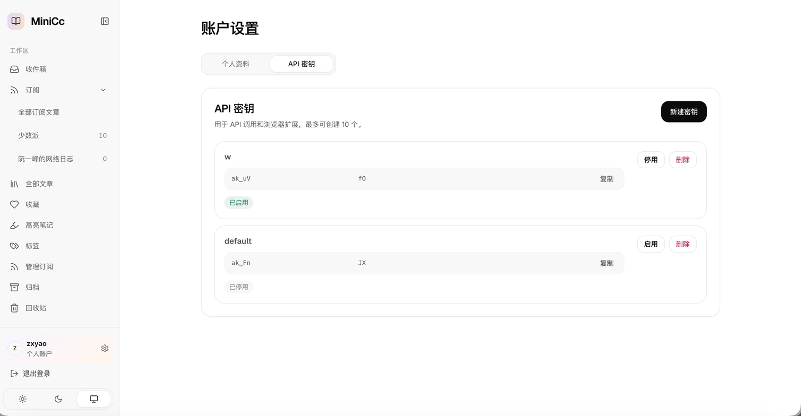

MiniCC 靠 Chrome 扩展收集网页。扩展在你自己的浏览器里提取正文，再把结果发到服务器，服务器从不自己去抓页面。所以需要登录才能看的文章也能保存。

## 安装扩展

扩展还没有上架 Chrome 应用商店，需要从源码构建后以开发者模式加载。

1. 在仓库根目录安装依赖并构建扩展：

   ```bash
   pnpm install --frozen-lockfile
   pnpm build:ext
   ```

2. 打开 `chrome://extensions/`，打开右上角的**开发者模式**。
3. 点**加载已解压的扩展程序**，选择 `src/web-extension/dist` 目录。

以后重新构建了扩展，记得在扩展管理页重新加载它，并刷新已经打开的文章标签页。

## 连接服务器

扩展用 API 密钥访问你的服务器。

1. 在 MiniCC 里打开账户设置，切到 **API 密钥**标签页，点**新建密钥**，再点**复制**。第一次启动时系统已经建好了一个叫 `default` 的密钥，也可以直接用它。每个账号最多可以有 10 个密钥。

   

2. 点浏览器工具栏上的扩展图标，再点右上角的齿轮，填入 API URL 和密钥，点 **Save**。

   API URL 是提供 `/api` 的那个地址，不带 `/api`。用 Compose 部署时是 `http://localhost:5000`，从源码运行 API 时是 `http://localhost:5001`。部署到自己的域名后，填域名地址，例如 `https://minicc.example.com`。

## 保存页面

打开要保存的页面，点扩展图标。弹窗里有三个按钮，最适合当前页面的那个会高亮显示。


**Save Article** 在浏览器里提取可读正文，连同标题、作者、摘要和封面一起保存。页面上找不到正文时，这个按钮不可用。

**Save Link** 只保存地址、标题、摘要和封面，适合视频页和没有正文的页面。YouTube 的视频、Shorts 和播放列表会读取官方提供的标题和缩略图。

**Copy Markdown** 把正文（或者一个 Markdown 链接）复制到剪贴板，开头带 YAML 元数据：标题、地址、日期，以及能取到的作者和页面标签。它不会往 MiniCC 里存任何东西。

## 重复保存同一个页面

MiniCC 按规范化后的网址识别同一篇文章，例如会忽略 `utm_*` 这类追踪参数。再次保存已有的页面时，会更新原来那篇，不会多出一篇重复的。

- 文章在回收站里的话，会被恢复。
- 标签、笔记、收藏和归档状态都保留。
- 正文没有变化时，阅读进度和高亮保持不变。
- 正文有变化时，MiniCC 换上新正文，阅读进度从头开始。已有的高亮会在下次打开文章时按原文重新定位，找不到原文的高亮会被标记出来，笔记仍然保留。

只有摘要的订阅文章，打开原文页面点 **Save Article**，就能补全全文。
