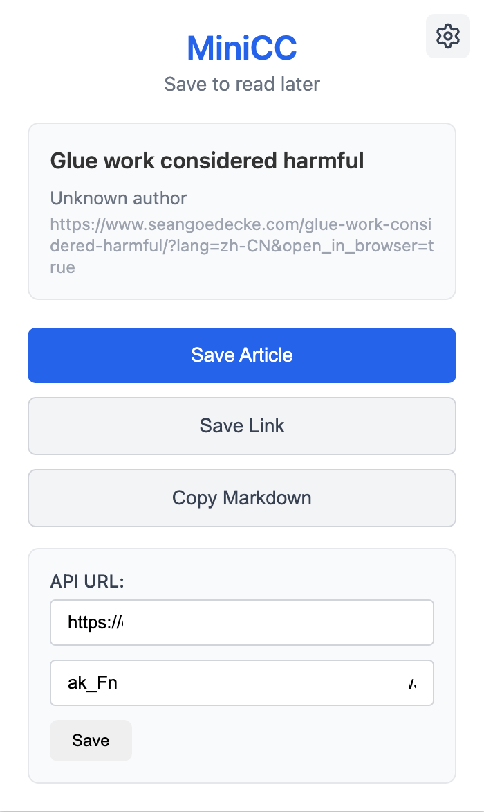

MiniCC 通过 Chrome 扩展来剪藏网页。所有正文提取都在你的浏览器本地完成，再将结果发送到服务器，服务端从不直接去抓取原网页。也正因如此，那些需要登录才能看的文章一样能顺利保存。

## 安装扩展

扩展目前尚未上架 Chrome 应用商店，需要从源码构建后以开发者模式加载：

1. 在仓库根目录安装依赖并构建扩展：

   ```bash
   pnpm install --frozen-lockfile
   pnpm build:ext
   ```

2. 在浏览器地址栏打开 `chrome://extensions/`，开启右上角的**开发者模式**。
3. 点击**加载已解压的扩展程序**，选中 `src/web-extension/dist` 目录。

日后如果重新构建了扩展，记得回到扩展管理页点击刷新，并重新加载已经打开的文章标签页。

## 连接服务器

扩展通过 API 密钥与你的服务器通信：

1. 在 MiniCC 中打开账户设置，切到 **API 密钥**标签页，点**新建密钥**再点**复制**。系统首次启动时已经自带了一个名为 `default` 的密钥，直接拿来用也可以。每个账号最多创建 10 个密钥。

   

2. 点击浏览器工具栏上的扩展图标，再点右上角的齿轮进入设置，填入 API URL 和密钥后点 **Save**。

   这里的 API URL 指的是对外提供 `/api` 服务的根地址，末尾不要带 `/api`。使用 Compose 部署时填 `http://localhost:5000`，从源码运行 API 时填 `http://localhost:5001`；部署到自己的域名后则填实际域名，例如 `https://minicc.example.com`。

## 保存页面

打开想收藏的网页，点一下扩展图标。弹窗里有三个按钮，扩展会自动高亮最适合当前页面的那一项。



- **Save Article**：在浏览器里提取可读正文，连同标题、作者、摘要和封面图一起入库。如果页面上没有可提取的正文，这个按钮会置灰。
- **Save Link**：只保存网址、标题、摘要和封面，适合视频页或非文章类页面。针对 YouTube 的视频、Shorts 和播放列表，会自动读取官方标题与缩略图。
- **Copy Markdown**：把正文（或一条 Markdown 链接）复制到剪贴板，并在开头附上 YAML 元数据（标题、网址、日期，以及能提取到的作者和页面标签）。此操作不会往 MiniCC 里写入任何数据。

## 重复保存同一个页面

MiniCC 会对网址做规范化处理（例如自动去掉 `utm_*` 这类追踪参数），以此判断是不是同一篇文章。再次保存已入库的页面时，系统会直接更新原文章，不会产生重复条目：

- 如果文章正躺在回收站里，会自动恢复出来。
- 原有的标签、笔记、收藏和归档状态全部保留。
- 正文没有变化时，阅读进度和高亮原封不动。
- 正文有更新时，MiniCC 会换上新正文，阅读进度归零。已有的高亮会在下次打开时重新按原文定位，实在匹配不上的会标出提示，但你写的笔记依然保留。

对于只有摘要的订阅文章，只要打开原文页面点一次 **Save Article**，就能把全文补齐。
