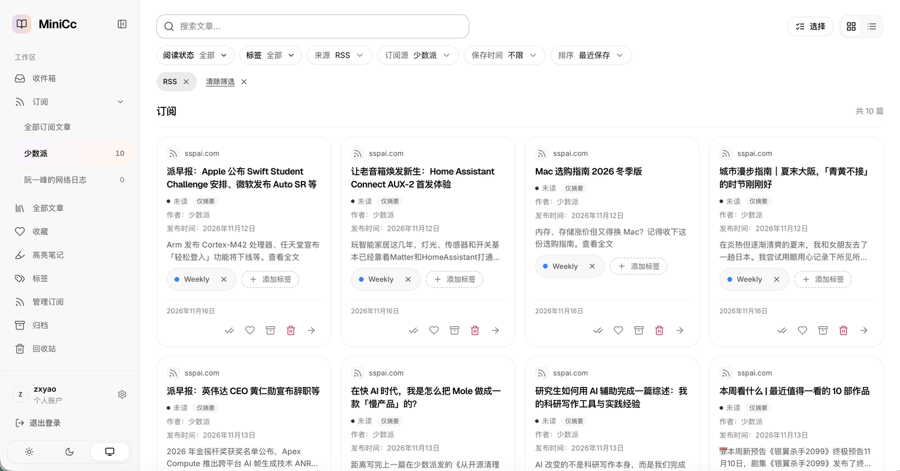

MiniCC 内置了 RSS 和 Atom 订阅功能。抓取进来的文章会和扩展剪藏的网页放进同一个文章库里，阅读、高亮、打标签的体验完全一致。

## 添加订阅

1. 点击侧边栏的**管理订阅**，再点**添加订阅**。
2. 填入 RSS 或 Atom 订阅地址；直接贴网站首页网址也可以，MiniCC 会自动去页面里找订阅链接。
3. 点**预览订阅**，确认最近几篇文章抓取正常，选好默认标签后点**确认添加**即可。

首次添加时，MiniCC 最多导入最近的 20 篇文章。此后系统每 30 分钟在后台检查一次更新；如果订阅源自己声明了更长的更新周期（比如 RSS 的 `ttl`），则以声明值为准。万一抓取失败，重试间隔会从 30 分钟逐步拉长，最长到 24 小时。

默认标签只对之后新导入的文章生效，修改它不会改动此前已经入库的内容。

## 浏览订阅文章

订阅抓回来的文章既会出现在**收件箱**，也会归类在侧边栏的**订阅**分组里。在文章库中把**来源**筛选为 RSS 后，界面会多出一个**订阅源**筛选项，方便单独浏览某一个订阅，同时不影响你选好的其他筛选条件。

有些订阅源只输出文章摘要，这类条目会标上**仅摘要**。打开原文网页，用浏览器扩展点一下 **Save Article**，就能把完整正文补全。

## 管理订阅

**管理订阅**页面会标出每个订阅源的当前状态（正常、已暂停或更新失败），并支持以下操作：

- **编辑**：修改订阅名称和默认标签，订阅地址本身不可更改。
- **立即刷新**：立刻拉取一次最新内容（已暂停的订阅源无法刷新）。
- **暂停** / **恢复**：暂停后后台不再检查该源的更新。
- **取消订阅**：停止继续抓取，但已经导入的文章都会完好保留。
- **删除已导入文章**：将该订阅源导入的文章批量移入回收站。如果某篇文章同时也来自其他订阅源，或者曾用扩展手动保存过，系统会自动跳过它。

如果订阅源日后修改了某篇已发布的文章，MiniCC 不会覆盖你本地已经导入的副本，原有的正文、标签和阅读状态都会原样保留。
