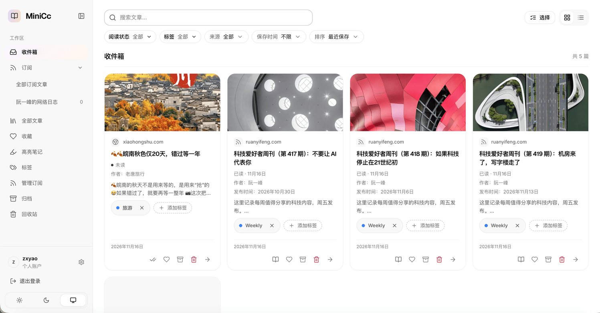
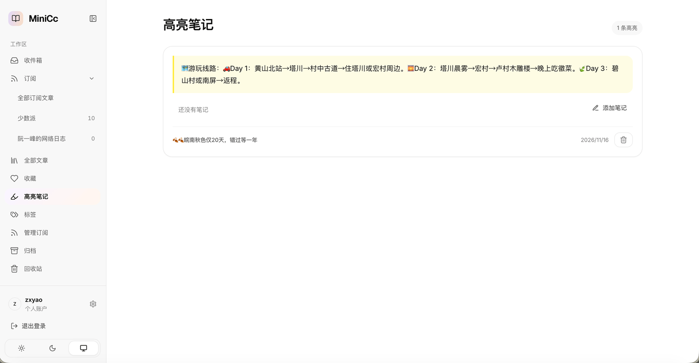
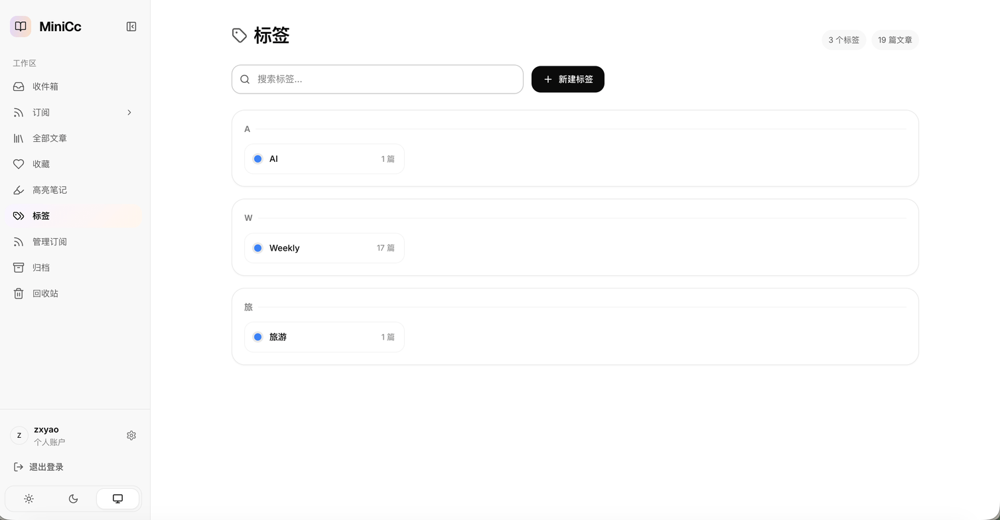

## 文章库

侧边栏的**工作区**分组里有五个视图：**收件箱**、**全部文章**、**收藏**、**归档**和**回收站**。归档的文章会离开收件箱，但仍然出现在全部文章里。

收件箱默认只显示未读文章。想在收件箱里看已读的文章，改一下**阅读状态**筛选就行。

顶部的搜索框做全文搜索。PostgreSQL 部署支持中文分词；SQLite 部署做子串匹配。搜索框下面是这些筛选条件：

| 筛选 | 选项 |
| --- | --- |
| 阅读状态 | 未读、阅读中、已读，可以多选 |
| 标签 | 最多选 10 个，文章要同时带有所选的全部标签 |
| 来源 | 浏览器收藏（扩展保存的）或 RSS |
| 内容类型 | 链接（只保存了链接的条目） |
| 订阅源 | 来源选 RSS 后出现，可以只看某一个订阅源 |
| 保存时间 | 最近一周、最近一个月，或自定义日期范围 |
| 排序 | 最近保存、最早保存、最近阅读；看订阅文章时还有最新发布 |

筛选条件都记在页面网址里，可以直接收藏某个视图。右上角可以在**卡片视图**和**列表视图**之间切换。

## 阅读器

点文章卡片打开阅读器。

阅读位置会自动保存，并在设备之间同步。你真正开始阅读之后才会保存：滚动过一小段，并停留几秒，文章状态会变成**阅读中**。只是打开看一眼，状态不会变。读到结尾时，页面底部会问你要不要**标记已读**；MiniCC 不会自动把文章标成已读。

工具栏上的按钮：

- **标记已读** / **标记未读**
- 收藏、归档、删除
- **从头阅读**：清除保存的位置，不改变阅读状态
- **阅读设置**：调整字号（16–28）、行高、宽度（窄、标准、宽）、字体（系统字体、衬线字体）和主题（跟随系统、浅色、深色、护眼）。设置保存在账号里，换浏览器登录也一样。**恢复默认**回到初始设置。
- **目录**：长文会自动生成目录。宽屏上目录固定在正文旁边，窄屏上从工具栏打开。

同一篇文章在两台设备上读到不同位置时，阅读器会提示你选择：**跳转**到另一台设备保存的位置，或者**留在这里**。

### 订阅文章只有摘要时

有些订阅源只提供摘要，阅读器顶部会显示**仅摘要**。打开原文页面，用扩展点 **Save Article**，就能补全正文，标签和笔记都会保留。

## 高亮与笔记

在阅读器里选中一段文字，点**高亮**。点已经高亮的文字，可以添加笔记或者删除高亮。

侧边栏的**高亮笔记**页面列出所有文章的高亮和笔记，点文章标题可以打开那篇文章。

文章正文更新后，MiniCC 会在新正文里重新查找每条高亮。找不到原文的高亮会显示“原文位置已失效”，笔记仍然保留。

## 标签

在文章卡片或阅读器里添加标签：输入名称搜索已有标签；没有同名标签时，选**创建「名称」**并挑一个颜色。

侧边栏的**标签**页面管理所有标签，可以新建、改名、换色和删除。删除标签会把它从所有文章和订阅源的默认标签里移除，文章本身不受影响。

## 批量操作

在文章库顶部点**选择**，或者在桌面上把鼠标移到卡片上勾选。选中后可以：标记已读、标记未读、收藏、取消收藏、归档、移回收件箱、添加标签、移除标签、删除。

批量操作只作用于已经加载出来的文章。部分文章处理失败时，它们会保持选中，可以直接重试。

## 删除、撤销和回收站

删除文章后，页面底部会出现撤销按钮，默认保留 10 秒。

删掉的文章进入**回收站**，保留 30 天，卡片上会显示剩余天数。在回收站里可以**恢复**文章，也可以**永久删除**。恢复的文章会带回原来的标签、高亮、笔记和阅读位置。**清空回收站**会一次永久删除回收站里的全部文章。

撤销时长和保留天数可以在服务器上调整，见[配置参考](/docs/configuration/#文章库)。

## 界面主题

侧边栏底部可以切换**浅色**、**深色**和**跟随系统**。阅读器有自己的主题设置，选**跟随系统**时会跟随这里的界面主题。
