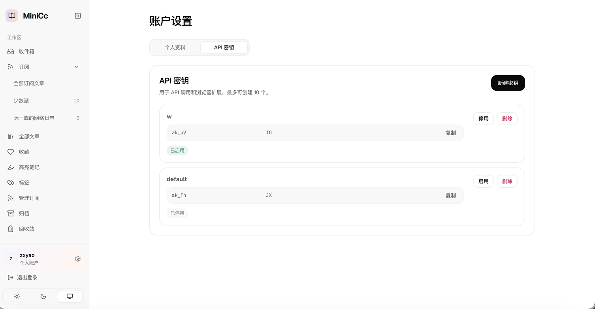
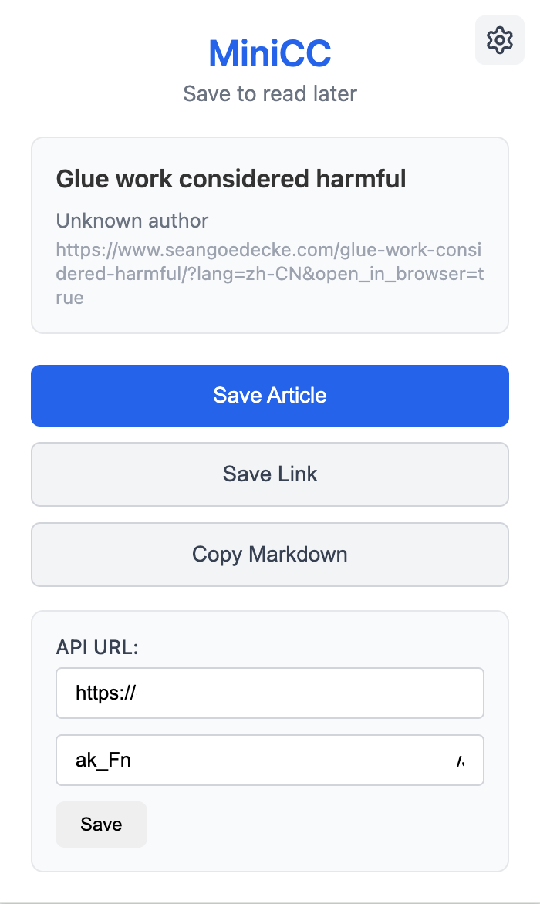

MiniCC clips web pages through a Chrome extension. Article extraction happens right inside your browser before anything is sent to the server; the server itself never fetches the page. That means pages behind a login work just as smoothly as public ones.

## Install the extension

The extension is not listed on the Chrome Web Store yet, so build it from source and load it in developer mode:

1. From the repository root, install dependencies and build the extension:

   ```bash
   pnpm install --frozen-lockfile
   pnpm build:ext
   ```

2. Open `chrome://extensions/` and toggle on **Developer mode** in the top-right corner.
3. Click **Load unpacked** and select `src/web-extension/dist`.

Whenever you rebuild the extension later, reload it on the extensions page and refresh any article tabs you already have open.

## Connect to your server

The extension authenticates to your server with an API key:

1. In MiniCC, open account settings, switch to the **API 密钥** (API Keys) tab, click **新建密钥** (New key), and copy it. First startup already creates a key named `default` that you can use right away. Each account supports up to 10 keys.

   

2. Click the extension icon in your browser toolbar, open the gear icon, paste your API URL and key, and click **Save**.

   Use the base URL that serves `/api`, without the `/api` suffix itself: `http://localhost:5000` with Compose, `http://localhost:5001` when running the API from source, or your own domain such as `https://minicc.example.com`.

## Save a page

Open any page you want to save and click the extension icon. The popup offers three actions and highlights the one that fits the current page best.



- **Save Article**: extracts readable content directly in your browser and saves it along with the title, author, summary, and cover image. Disabled when no article body is detected.
- **Save Link**: saves only the URL, title, summary, and cover, which works well for videos and non-article pages. For YouTube videos, Shorts, and playlists, it pulls the official title and thumbnail.
- **Copy Markdown**: copies the article (or a Markdown link) to your clipboard with YAML front matter containing the title, URL, date, and any available author or page tags. Nothing is saved to MiniCC.

## Saving the same page again

MiniCC identifies articles by their normalized URL, ignoring tracking parameters such as `utm_*`. Saving a page that is already in your library updates the existing entry instead of creating a duplicate:

- If the article is in the trash, it is restored automatically.
- Existing tags, notes, favorite, and archive states are preserved.
- If the body has not changed, your reading progress and highlights stay intact.
- If the body has changed, MiniCC swaps in the new text and resets your reading position. Highlights are re-matched the next time you open the article; any whose text disappeared are flagged while their notes remain safe.

For a feed post that only contains a summary, open the original page and click **Save Article** to pull in the full text.
