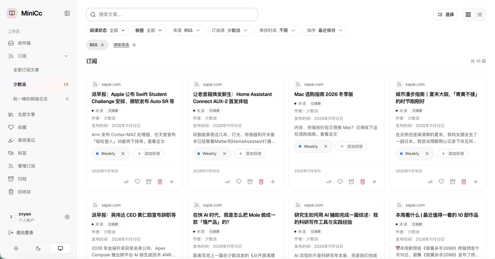

MiniCC supports RSS and Atom feeds natively. Incoming feed posts land in the same library as pages clipped with the browser extension, so you can read, highlight, and tag them the exact same way.

## Add a feed

1. Click **管理订阅** (Manage subscriptions) in the sidebar, then **添加订阅** (Add subscription).
2. Paste an RSS or Atom feed URL, or simply enter a website's address and let MiniCC discover the feed link automatically.
3. Click **预览订阅** (Preview) to make sure recent entries look right, pick any default tags, and click **确认添加** (Confirm).

When you first add a feed, MiniCC imports up to 20 recent entries. After that, it polls in the background every 30 minutes, or respects the feed's own interval (such as an RSS `ttl`) when that is longer. If a fetch fails, retries back off gradually from 30 minutes up to 24 hours.

Default tags only apply to articles imported going forward; changing them does not affect anything already in your library.

## Browse feed articles

Feed items show up in **收件箱** (Inbox) as well as under **订阅** (Subscriptions) in the sidebar. Setting the **来源** (Source) filter to RSS reveals a **订阅源** (Feed) filter so you can zero in on a single feed without losing your other filters.

Some feeds only publish excerpts, which appear marked as **仅摘要** (Summary only). Open the original article and click **Save Article** in the extension to pull in the full text.

## Manage feeds

The **管理订阅** (Manage subscriptions) page shows each feed's current state: normal, **已暂停** (Paused), or **更新失败** (Update failed). From there you can:

- **Edit**: change the feed title and default tags. The feed URL itself is read-only.
- **立即刷新** (Refresh now): check for new posts immediately (disabled while a feed is paused).
- **暂停** (Pause) / **恢复** (Resume): stop or resume background polling.
- **取消订阅** (Unsubscribe): stop future updates while keeping all previously imported articles.
- **删除已导入文章** (Delete imported articles): move articles imported from this feed to the trash. Anything that also belongs to another feed or was saved via the extension is skipped automatically.

If a feed later edits a post you have already imported, MiniCC leaves your copy untouched, keeping its text, tags, and reading status as they are.
