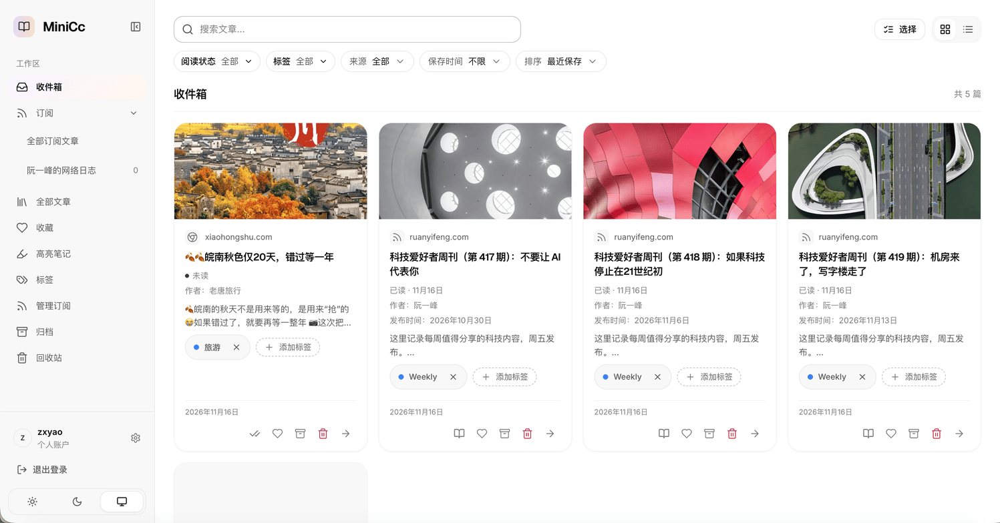
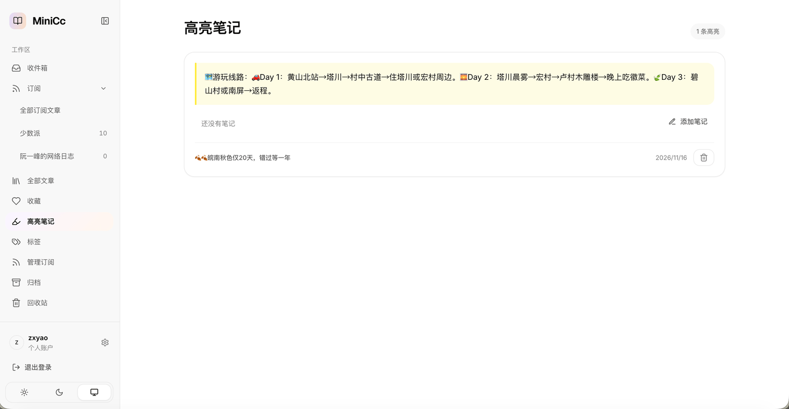
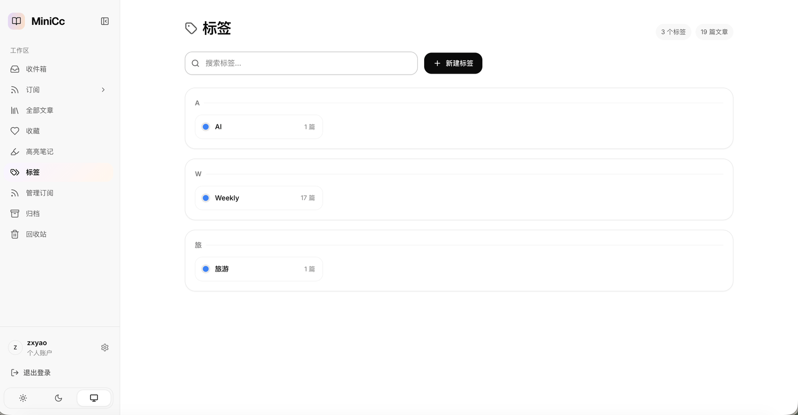

## Library

The **工作区** (Workspace) section in the sidebar offers five views: **收件箱** (Inbox), **全部文章** (All articles), **收藏** (Favorites), **归档** (Archive), and **回收站** (Trash). Archiving an article removes it from the inbox while keeping it in All articles.

By default, the inbox only shows unread articles. To include read ones, adjust the **阅读状态** (Reading status) filter.

The search bar at the top runs a full-text search: PostgreSQL uses Chinese word segmentation, while SQLite falls back to substring matching. Below the search bar, you can narrow down the list with these filters:

| Filter | Options |
| --- | --- |
| **阅读状态** (Reading status) | **未读** (Unread), **阅读中** (Reading), **已读** (Read); select any combination |
| **标签** (Tags) | Up to 10 tags; articles must match all selected tags |
| **来源** (Source) | **浏览器收藏** (saved via the extension) or RSS |
| **内容类型** (Content type) | **链接** (Link) for items saved as links only |
| **订阅源** (Feed) | Appears when the source is set to RSS; filters to a single feed |
| **保存时间** (Saved) | Past week, past month, or a custom date range |
| **排序** (Sort) | Recently saved, oldest saved, or recently read, plus newest published when browsing feeds |

Every active filter is reflected in the page URL, so you can bookmark any filtered view directly. In the top-right corner, you can toggle between **卡片视图** (Card view) and **列表视图** (List view).

## Reader

Click any article card to open it in the reader.

Your reading position is saved automatically and synced across devices. Saving only kicks in once you actually start reading: scroll a short way down and pause for a few seconds, and the status changes to **阅读中** (Reading). Merely opening an article for a quick look leaves its status untouched. When you reach the end, a prompt asks if you want to **标记已读** (Mark as read); MiniCC never marks an article read automatically.

Toolbar actions include:

- **标记已读** (Mark as read) / **标记未读** (Mark as unread)
- Favorite, archive, and delete
- **从头阅读** (Start over): resets your saved position without changing the reading status
- **阅读设置** (Reader settings): font size (16–28), line height, column width (narrow, standard, wide), typeface (system or serif), and theme: **跟随系统** (System), **浅色** (Light), **深色** (Dark), or **护眼** (Sepia). Preferences are saved to your account and carry over across browsers. Click **恢复默认** (Reset) to restore the defaults.
- **目录** (Contents): generated automatically for longer articles. On wide screens it stays pinned beside the text; on smaller screens, open it from the toolbar.

If you have read the same article to different places on two devices, the reader prompts you to either **跳转** (Jump) to the other device's position or **留在这里** (Stay here).

### Feed articles with only a summary

Some feeds only publish excerpts, in which case the reader shows **仅摘要** (Summary only) at the top. Open the original page and click **Save Article** in the extension to pull in the full text while keeping all existing tags and notes.

## Highlights and notes

Select any passage in the reader and click **高亮** (Highlight). Click an existing highlight to attach a note or remove it.

The **高亮笔记** (Highlights) page in the sidebar gathers every highlight and note across your library; click an article title to jump straight back to it.

When an article's body is updated, MiniCC tries to re-anchor each highlight in the new text. If a passage can no longer be found, it is labeled **原文位置已失效** (original position no longer found), while your note stays intact.

## Tags

You can tag articles from either a library card or the reader. Type to search existing tags; if nothing matches, select **创建「name」** (Create "name") and pick a color.

The **标签** (Tags) page in the sidebar is where you create, rename, recolor, and delete tags. Deleting a tag strips it from all articles and feed defaults without touching the articles themselves.

## Batch actions

Click **选择** (Select) at the top of the library, or hover over a card on desktop and check its box. Once selected, you can mark articles read or unread, favorite or unfavorite, archive, move back to the inbox, add or remove tags, or delete them in one go.

Batch actions only apply to articles currently loaded on the page. If any items fail, they remain selected so you can retry immediately.

## Delete, undo, and the trash

Right after deleting articles, an undo banner appears at the bottom of the page for 10 seconds by default.

Deleted items stay in **回收站** (Trash) for 30 days, with each card showing how many days are left. From there you can **恢复** (Restore) an article—bringing back its tags, highlights, notes, and reading progress—or **永久删除** (Delete permanently). **清空回收站** (Empty trash) permanently removes everything in the trash at once.

Both the undo window and trash retention period can be configured on the server. See the [configuration reference](/en/docs/configuration/#library).

## Interface theme

Switch between **浅色** (Light), **深色** (Dark), and **跟随系统** (System) at the bottom of the sidebar. The reader has its own theme setting; when set to **跟随系统** (System), it follows whichever interface theme is active here.
